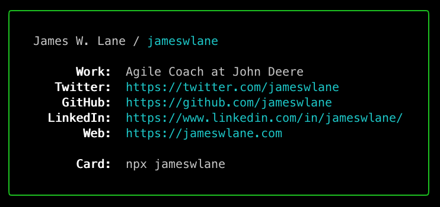

# James W. Lane

[](https://www.npmjs.com/package/jameswlane)
[](https://github.com/jameswlane/terminal-card/actions/workflows/ci.yml)
[](https://codecov.io/gh/jameswlane/terminal-card)
[](LICENSE)

Code for my personal npm card: `npx jameswlane`

```bash
npx jameswlane
```



## Flags

- `--plain` — print the card without the border (useful for scripts, e.g. `npx jameswlane --plain | grep github`)
- `--version` — print the package version
- `--help` — show usage

## Development

```bash
pnpm install
pnpm build    # compile TypeScript to lib/
pnpm test     # run the vitest suite
pnpm lint     # biome check
```

---

The idea for this card was from [bitandbang](https://x.com/bitandbang) who's source you can see [here](https://github.com/bnb/bitandbang).
